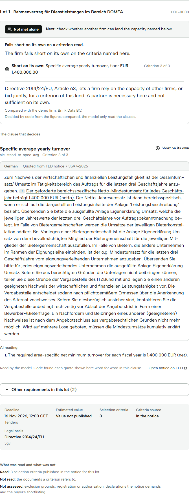
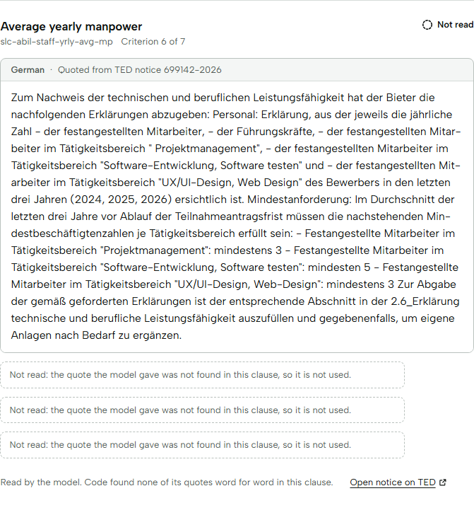
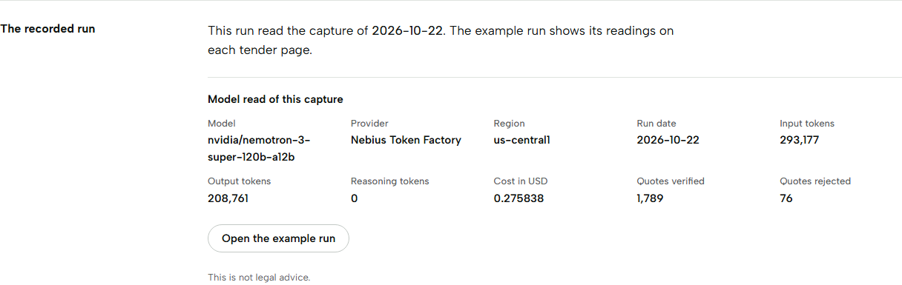
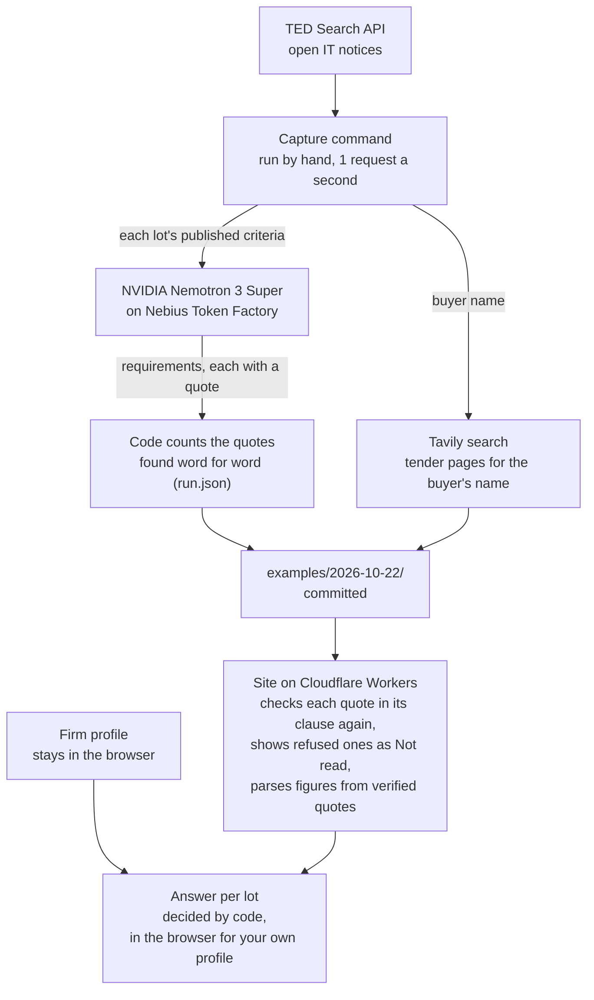

# Pagefifty

The rule your firm can't meet alone is on page fifty. Read it first.

**See it run:** [pagefifty.atfyigtaran.workers.dev](https://pagefifty.atfyigtaran.workers.dev), no
account and no upload. The home page opens on
[notice 713597-2026](https://pagefifty.atfyigtaran.workers.dev/example/713597-2026), a near miss for an
invented demo firm.

**The recorded run:** [examples/2026-10-22/](examples/2026-10-22/) holds every notice, model
reading and search the site replays. Replay it on your machine with no key and Node 24.15 or newer:
`npm ci`, then `npm run dev`, and open the local address it prints.

Pagefifty tells a small IT firm in the Netherlands, Belgium or Germany whether it meets an open EU
tender's published selection criteria, before anyone starts work on a bid. It quotes the clause
that decides, from the tender's own text, with a link to the notice on TED. On 22 October 2026 it
went through 323 open IT tenders. NVIDIA's open model Nemotron 3 Super, on Nebius Token Factory,
read every selection criterion published in them, 288 lots in the 200 notices that publish criteria
in the notice, for USD 0.28, and code refused 76 of the model's 1,865 quotes as ones it could not
verify in the tender.

Pagefifty is not legal advice. It points at the clause and the source, and the decision stays with
you.

## The answer for one tender



Notice 713597-2026, lot 1: the buyer asks for EUR 1,400,000 a year in this field. The demo firm
made EUR 1,090,000, 1,210,000 and 1,240,000, so its best year and its three-year average of EUR
1,180,000 both fall short, the lot reads "Not met alone", and the German sentence that sets the
floor is underlined.

## What it refuses



Notice 699142-2026, criterion 6: the model turned the clause's double quotes into single ones, so
code found none of its three quotes and the criterion reads "Not read".

- A quote that code cannot verify in its clause: one it cannot find word for word, or one shorter
  than 12 characters. That was 76 of 1,865 on 22 October.
- A number from the model's own fields. Every amount, count and year is parsed by code from a
  verified quote.
- A "Go" while part of a lot's criteria sits in documents this version does not read.
- A web search result as evidence. Pages a web search for the buyer found are shown apart,
  unchecked, and change no answer.
- Legal advice.

## The record of the run



The page [How the AI is used](https://pagefifty.atfyigtaran.workers.dev/ai) shows the model, its
region, the tokens and the cost of the run the site serves.

## How it works



A capture command, run by hand, asks TED for open IT notices and sends each lot's published
selection criteria to the model, which returns typed requirements as JSON, each with a verbatim
quote. The capture keeps every quote the model gave, records how many code found word for word,
and writes the capture to `examples/`. The site serves that capture, so no visitor waits on a model
call and nothing metered runs while you click around. Each page checks every quote against its
clause again, shows refused ones as "Not read", and parses the figures from the verified quotes.
Each lot then gets one of three answers, "Go", "Not met alone" or "Ask first", decided by code
against the firm's profile, in the browser for your own firm. A fourth answer, "No-go", is reserved
and not set in this version.

## Limits

- It reads the notice, not the document pack. A lot whose criteria sit in the procurement documents
  or the ESPD says so. On 22 October, 123 of the 323 notices published no selection criteria in the
  notice at all.
- For the demo firm, 5 of the 323 notices read "Not met alone" and 318 read "Ask first". None reads
  a clean Go.
- There is one live model run so far. Two more would show how much the model's reading varies
  between runs.
- The capture covers IT notices (CPV 72 and 48) that buyers in the Netherlands, Belgium and Germany
  published in the 14 days before it, and only tenders on TED, where tenders above the EU thresholds
  must be published, not every open tender.
- The demo firm is invented.
- The model is listed for us-central1, a US region. Only public tender text is sent to it, never a
  firm profile.

## Accessibility

Every page comes in Light, Dark and Device themes, and every answer carries an icon and a word,
never colour alone. The target is WCAG 2.2 AA. `npm run a11y:live` runs an automated axe audit of
the built site in the light and dark themes, through the
[dev-browser](https://www.npmjs.com/package/dev-browser) command line tool, which it needs installed.

## Tests

```sh
npm test
```

CI runs the test suite with coverage, lint, `npm run gate` and `npm run gate:repo` on every pull
request and every push to main. The vulnerability and licence scans run on main only.
`npm run test:e2e` and `npm run a11y:live` drive a browser through the dev-browser command line
tool and need it installed. How the product meets the EU AI Act's transparency duty is in
[docs/ai-act.md](docs/ai-act.md), and what it does with personal data in
[docs/privacy-accountability.md](docs/privacy-accountability.md).

## Data sources

- Open tenders: the EU's TED Search API (Tenders Electronic Daily), public and keyless.
- Reading free-text criteria: an NVIDIA Nemotron model served by Nebius Token Factory.
- Tender pages from a web search for the buyer: Tavily search, shown as unchecked web results.

For each of the 200 notices whose criteria are in the notice, the capture runs one Tavily search on
the buyer's name plus fixed words for tenders and awards. Code keeps only results whose title or
address carries a tender word or a portal's name (658 of 1,000 on 22 October, 27 notices left with
none) and shows them apart, unchecked, noting that a listed page may be another buyer's.

Each capture folder's README gives TED's reuse terms and what was scrubbed. The example run replays
the newest capture whose `--open-after` instant is at or after the submission cutoff (30 Oct 2026,
18:00 CET), so every tender it shows was still open then: today that is `examples/2026-10-22/`.

## Setup

Node 24.15 or newer, as the `engines` field of `package.json` says (`.nvmrc` names only the major
version, 24).

```sh
npm ci
npm run dev
```

Then open the local address `npm run dev` prints. With no key file the app serves the recorded
captures in `examples/`. Only a live capture reads keys, from `.env` (copy `.env.example`).

## Capturing open tenders

```sh
npm run capture
```

The command searches TED for open IT notices (CPV 72000000 and 48000000) from buyers in the
Netherlands, Belgium and Germany, published in the last 14 days. `--since YYYYMMDD` starts the
window on another day. `--open-after <instant>` (an instant with its zone, for example
`2026-10-30T17:00:00Z`) leaves out every notice with a lot that closes at or before it. It downloads
each notice's XML at one request a second, keeps active notices and their latest versions only,
removes contact data, and writes `examples/<date>/`, named after the day the run started in
Europe/Amsterdam. On its next build the site lists the newest capture under Tenders, while the
example run keeps to the rule under "Data sources". A plain (dry) run holds no model readings, so
the home page shows no figure for it. After a live run, `node scripts/figure.mjs <date>` writes the
figure.

Downloads are kept in `.capture-cache/`, so a later run asks TED again only for the search and for
notices it does not hold yet. Every run that gets past its flags leaves a record in
`.capture-cache/runs/`, failed runs included. A written capture also holds it as `run.json`.

Exit codes: 0 the capture was written; 1 the run failed and wrote nothing; 2 refused before any
request (a bad flag, a folder for that day already exists, another run is in progress, or a live run
without its switch or keys); 130 stopped with Ctrl+C.

### Metered calls and the go-live switch

The model read (Token Factory) and the search (Tavily) cost money per call. They stay off: a plain
run logs `(dry-run) WOULD call <provider> <operation>` for each call it would have made and calls
nothing. A live run needs the `--live` flag and `PAGEFIFTY_LIVE=1` set in the shell for that one
command:

```sh
PAGEFIFTY_LIVE=1 npm run capture -- --live --cap 50
```

`PAGEFIFTY_LIVE` is read from the shell only. A value in `.env` does nothing, and `--live` with any
value other than `1` stops before any request. `--cap N` is required with `--live`, a whole number
from 0 to 1000. It counts every attempt across both providers, retries included, and each call past
it is refused and logged.

A live run reads `NEBIUS_API_KEY` and `TAVILY_API_KEY` from `.env` at the repository root and hands
each key to its own provider's calls only. The keys never reach `process.env`, a log line, a run
record or the capture. A live run is billed: it sends each lot's criteria to Token Factory, then
runs the buyer searches on Tavily, up to `--cap` attempts across both, and `run.json` records every
attempt.

## Built with

Nebius Token Factory, NVIDIA Nemotron 3 Super (`nvidia/nemotron-3-super-120b-a12b`), Tavily Search
API, the TED Search API, SvelteKit, Svelte 5, TypeScript, Cloudflare Workers, Zod, fast-xml-parser
and Vitest.

## License

Code: MIT ([LICENSE](LICENSE)). The notices under `examples/` are TED's, © European Union, reused
under the terms each capture folder's README quotes. Fonts: IBM Plex, under the SIL Open Font
License 1.1.
