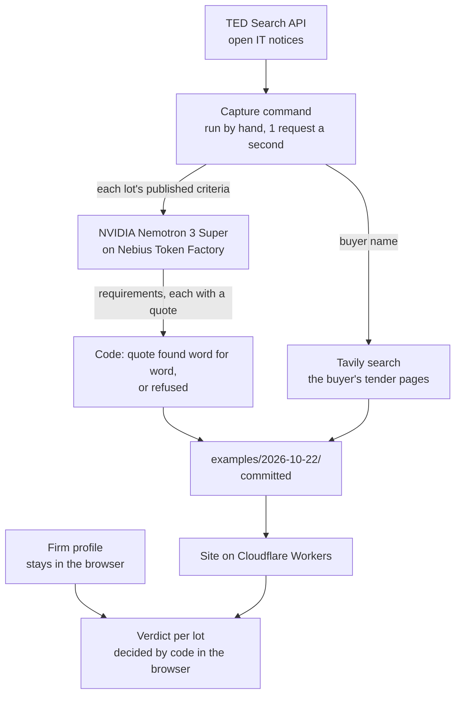

# Pagefifty

The rule your firm can't meet alone is on page fifty. Read it first.

**See it run:** [pagefifty.atfyigtaran.workers.dev](https://pagefifty.atfyigtaran.workers.dev), no
account and no upload. Start with
[notice 713597-2026](https://pagefifty.atfyigtaran.workers.dev/example/713597-2026), a near miss.

**The recorded run:** [examples/2026-10-22/](examples/2026-10-22/) holds every notice, model
reading and search the site replays. Replay it on your machine with no key and Node 24.15 or newer:
`npm install`, then `npm run dev`, and open the local address it prints.

Pagefifty tells a small IT firm in the Netherlands, Belgium or Germany whether it meets an open EU
tender's published selection criteria, before anyone spends two days on a bid. It quotes the clause
that decides, from the tender's own text, with a link to the notice on TED. On 22 October 2026 it
went through 323 open IT tenders. NVIDIA Nemotron 3 Super on Nebius Token Factory read every
selection criterion published in them for USD 0.28, and code refused 76 of the model's 1,865 quotes
because they were not word for word in the tender.

Pagefifty is not legal advice. It points at the clause and the source, and the decision stays with
you.

## The answer for one tender


Notice 713597-2026, lot 1: the demo firm turns over EUR 1.24M against a floor of EUR 1,400,000, so
the lot reads "Not met alone", and the German sentence that sets the floor is underlined.

## What it refuses


Notice 699142-2026, criterion 6: the model turned the clause's double quotes into single ones, so
code found none of its three quotes and the criterion reads "Not read".

- A quote code cannot find word for word in its clause. That was 76 of 1,865 on 22 October.
- A number from the model's own fields. Every amount, count and year is parsed by code from a
  verified quote.
- A Go while part of a lot's criteria sits in documents this version does not read.
- A web search result as evidence. The buyer's tender pages a web search found are shown apart,
  unchecked, and change no verdict.
- Legal advice.

## The record of the run


The page [How the AI is used](https://pagefifty.atfyigtaran.workers.dev/ai) shows the model, its
region, the tokens and the cost of the run the site serves.

## How it works



A capture command, run by hand, asks TED for open IT notices and sends each lot's published
selection criteria to the model, which returns typed requirements as JSON, each with a verbatim
quote. From there code does the work: it looks for every quote in its clause and refuses the ones it
cannot find, parses the figures out of the verified quotes, and writes the capture to `examples/`.
The site serves that capture, so no visitor waits on a model call and nothing metered runs while you
click around. Each lot gets one of four answers, Go, No-go, Not met alone or Ask first, decided in
the browser against the firm's profile, which never leaves it.

## Limits

- It reads the notice, not the document pack. A lot whose criteria sit in the procurement documents
  or the ESPD says so.
- For the demo firm, 5 of the 323 notices read "Not met alone" and 318 read "Ask first". None reads
  a clean Go.
- There is one live model run so far.
- The capture covers IT notices (CPV 72 and 48) that buyers in the Netherlands, Belgium and Germany
  published in the 14 days before it, not every open tender.
- The demo firm is invented.
- The model runs in a US region (us-central1). Only public tender text is sent to it, never a firm
  profile.

## Accessibility

Every page comes in Light, Dark and Device themes, and every answer carries an icon and a word,
never colour alone. The target is WCAG 2.2 AA; `npm run a11y:live` runs an axe audit of the built
site in the light and dark themes, through the
[dev-browser](https://www.npmjs.com/package/dev-browser) command line tool, which it needs installed.

## Data sources

- Open tenders: the EU's TED Search API (Tenders Electronic Daily), public and keyless.
- Reading free-text criteria: an NVIDIA Nemotron model served by Nebius Token Factory.
- A buyer's tender pages on the web: Tavily search, shown as unchecked web results.

Each capture folder's README gives TED's reuse terms and what was scrubbed. The example run replays
the newest capture made with `--open-after` at or after the submission cutoff (30 Oct 2026, 18:00
CET).

## Setup

Node 24.15 or newer, as the `engines` field of `package.json` says (`.nvmrc` names only the major
version, 24).

```sh
npm install
npm run dev
```

Then open the local address `npm run dev` prints. With no key file the app serves the recorded
captures in `examples/`. Only a live capture reads keys, from `.env` (copy `.env.example`).

## Capturing open tenders

```sh
npm run capture
```

The command searches TED for open IT notices (CPV 72000000 and 48000000) from buyers in the
Netherlands, Belgium and Germany, published in the last 14 days. `--since YYYYMMDD` starts the
window on another day. `--open-after <instant>` (an instant with its zone, for example
`2026-10-30T17:00:00Z`) leaves out every notice with a lot that closes at or before it. It downloads
each notice's XML at one request a second, keeps active notices and their latest versions only,
removes contact data, and writes `examples/<date>/`, named after the day the run started in
Europe/Amsterdam. The site serves the newest capture on its next build.

Downloads are kept in `.capture-cache/`, so a later run asks TED again only for the search and for
notices it does not hold yet. Every run that gets past its flags leaves a record in
`.capture-cache/runs/`, failed runs included; a written capture also holds it as `run.json`.

Exit codes: 0 the capture was written; 1 the run failed and wrote nothing; 2 refused before any
request (a bad flag, a folder for that day already exists, another run is in progress, or a live run
without its switch or keys); 130 stopped with Ctrl+C.

### Metered calls and the go-live switch

The model read (Token Factory) and the search (Tavily) cost money per call. They stay off: a plain
run logs `(dry-run) WOULD call <provider> <operation>` for each call it would have made and calls
nothing. A live run needs the `--live` flag and `PAGEFIFTY_LIVE=1` set in the shell for that one
command:

```sh
PAGEFIFTY_LIVE=1 npm run capture -- --live --cap 50
```

`PAGEFIFTY_LIVE` is read from the shell only. A value in `.env` does nothing, and `--live` with any
value other than `1` stops before any request. `--cap N` is required with `--live`, a whole number
from 0 to 1000. It counts every attempt across both providers, retries included, and each call past
it is refused and logged.

A live run reads `NEBIUS_API_KEY` and `TAVILY_API_KEY` from `.env` at the repository root and hands
each key to its own provider's calls only. The keys never reach `process.env`, a log line, a run
record or the capture. A live run is billed: it sends each lot's criteria to Token Factory, then
runs the buyer searches on Tavily, up to `--cap` attempts across both, and `run.json` records every
attempt.

## Built with

Nebius Token Factory, NVIDIA Nemotron 3 Super (`nvidia/nemotron-3-super-120b-a12b`), Tavily Search
API, the TED Search API, SvelteKit, Svelte 5, TypeScript, Cloudflare Workers, Zod, fast-xml-parser
and Vitest.

## License

MIT
